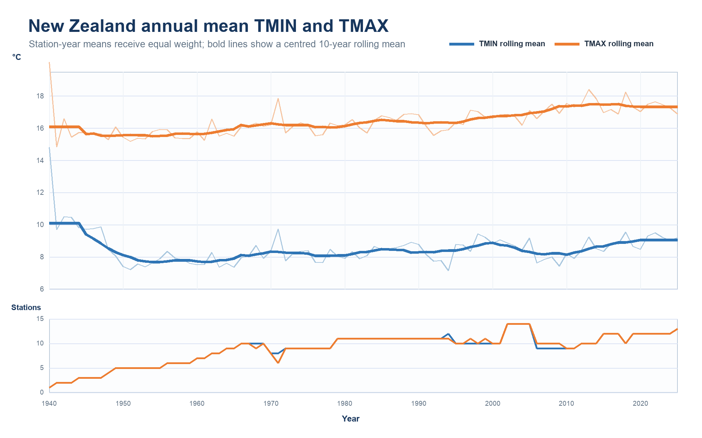
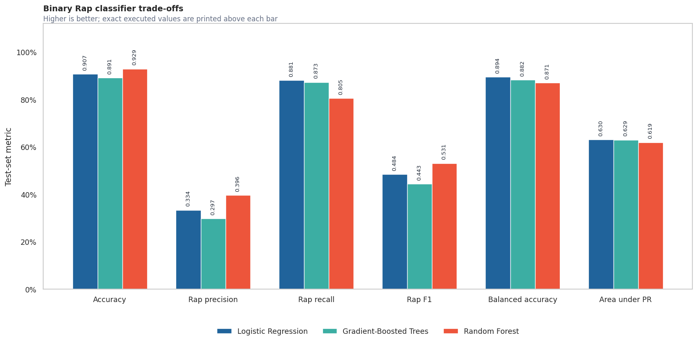

# Scalable Data Science with Apache Spark

Two independent case studies showing how distributed data engineering, machine learning, and careful evaluation change when datasets exceed single-machine workflows.

## Projects

### [GHCN-Daily Spark Climate Analytics](https://github.com/sahil-mann/ghcn-daily-spark-climate-analytics)

Distributed processing and validation of approximately **3.19 billion daily climate observations**. The project covers explicit schemas, fixed-width metadata, station enrichment, bidirectional identifier checks, geospatial distance analysis, time-series aggregation, and climate visualisation.



### [Million Song Spark ML and Recommender](https://github.com/sahil-mann/million-song-spark-ml-recommender)

Scalable audio classification and implicit-feedback recommendation using the Million Song Dataset. The project covers programmatic schema construction, feature screening, imbalanced binary and multiclass classification, ALS recommendation, and ranking evaluation.



## Portfolio highlights

- Reduced large problems to the smallest defensible data grain before expensive joins and aggregations.
- Built reusable validation checks for identifiers, duplicates, coverage, train-test separation, and cold-start conditions.
- Used Spark SQL and MLlib for distributed data preparation, classification, and recommendation.
- Collected only bounded summaries for driver-side visualisation.
- Reported limitations alongside metrics to avoid overstating model or analytical performance.

## Technology stack

Python · Apache Spark · PySpark · Spark SQL · MLlib · Azure Blob Storage · Parquet · Pandas · NumPy · Matplotlib · Seaborn · JupyterLab · Git

## Repository map

```text
scalable-data-science-spark
├── README.md
├── assets/
├── docs/
├── CITATION.cff
└── LICENSE
```

## Public-release scope

The public repositories present methodology, validated findings, architecture, selected figures, limitations, and reproducibility guidance. Raw datasets, institutional storage details, credentials, assessment question sheets, grading documents, checkpoints, and generated cloud outputs are excluded.

## Author

**Sahil Mann**  
Data science postgraduate student based in Christchurch, New Zealand
