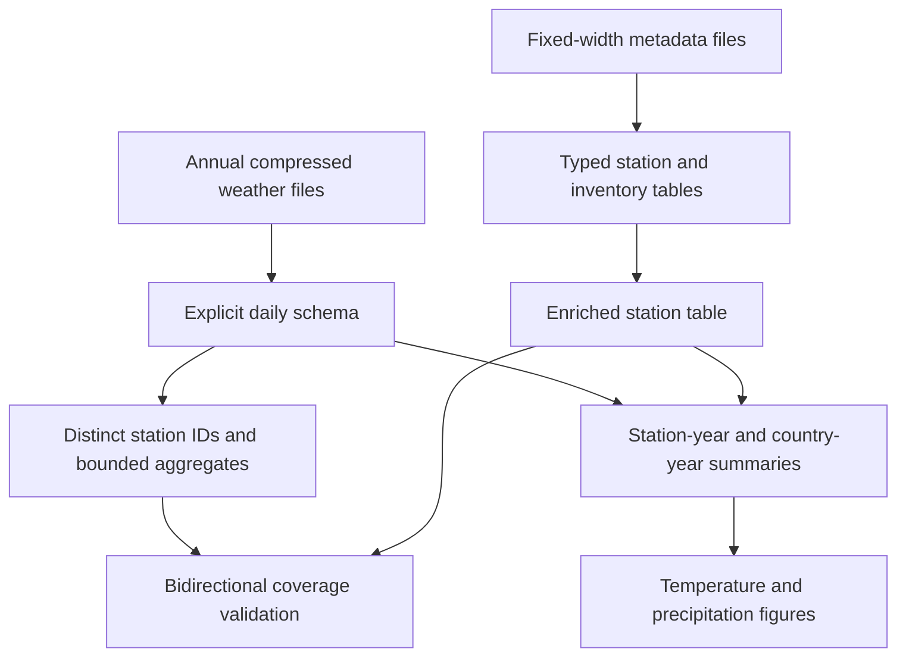
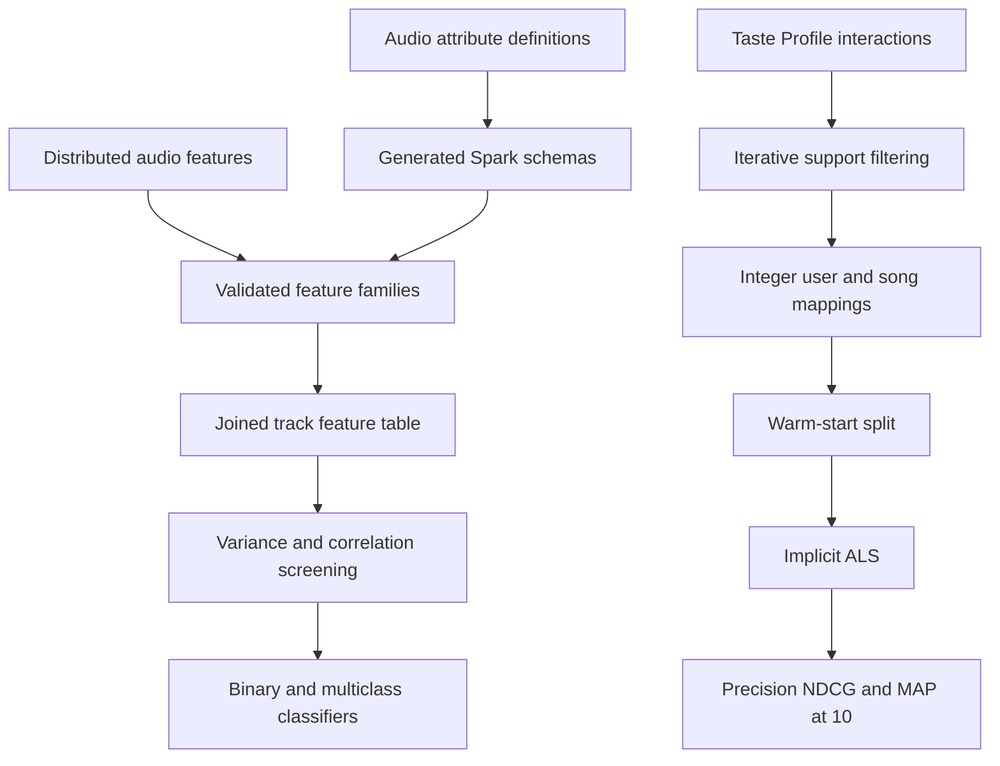

# Project Architecture

## Climate analytics pipeline

## Music ML pipeline

## Shared design principles

- Inspect storage metadata before scanning large files.
- Make observational grain explicit before joining.
- Validate identifiers, nulls, duplicates, and coverage before modelling.
- Fit preprocessing only on training data.
- Check class balance before selecting metrics.
- Aggregate in Spark and collect only bounded results for plotting.
- Treat cloud checkpoints and cached intermediates as execution tools, not public repository assets.

